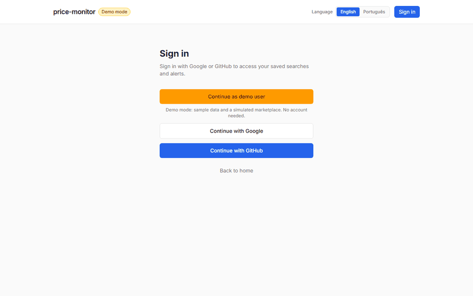
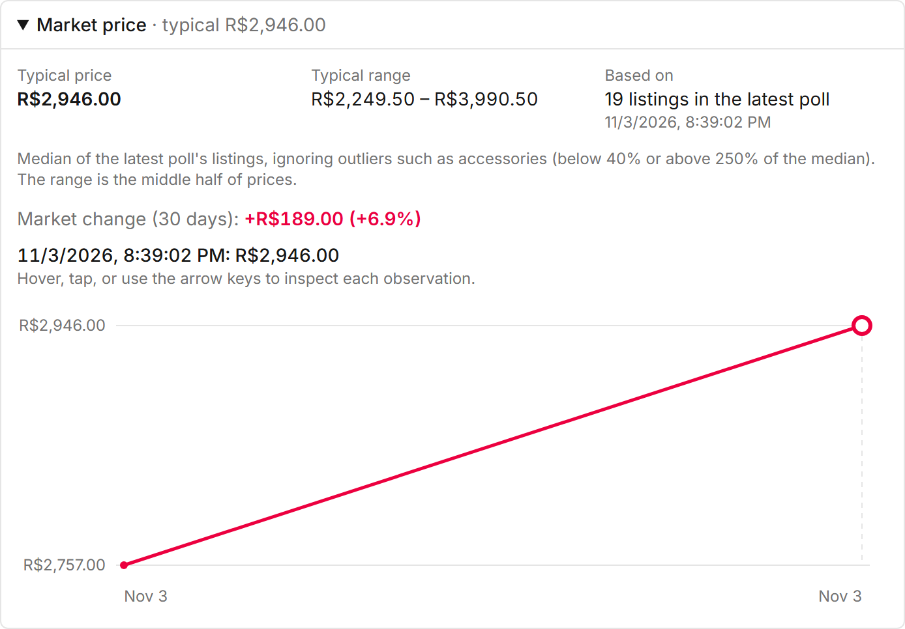
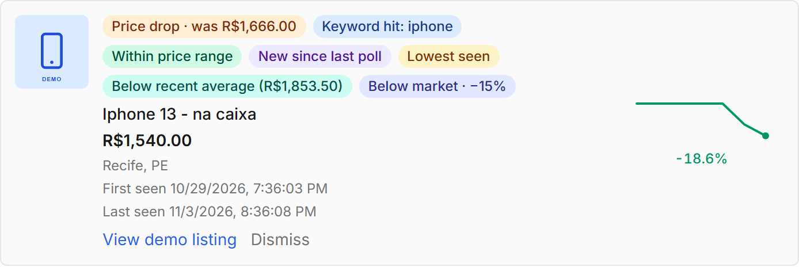
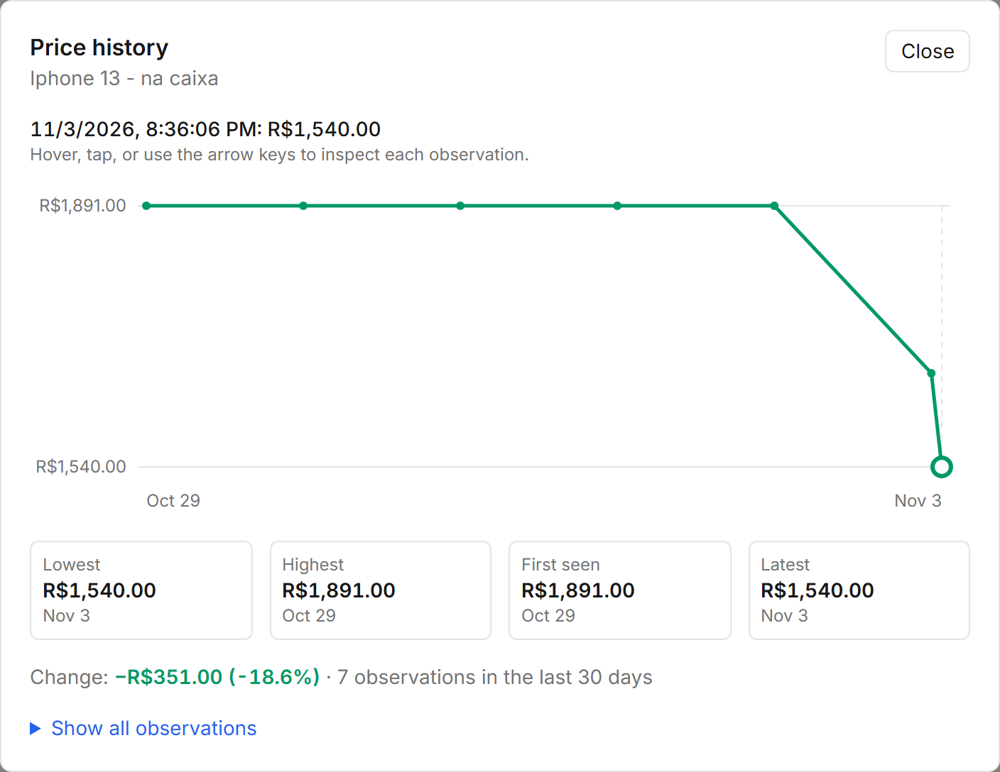
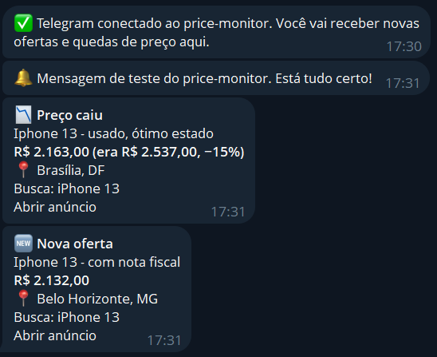
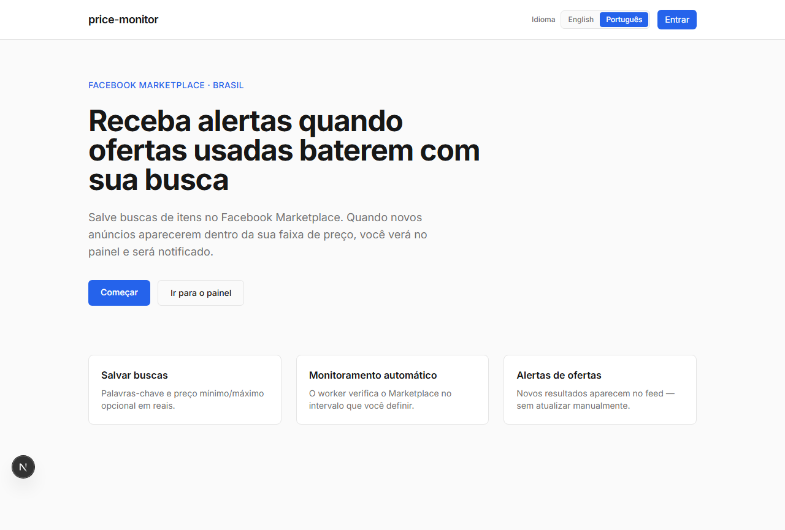
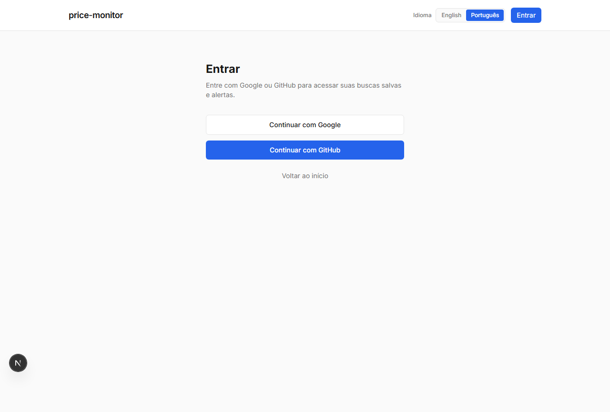
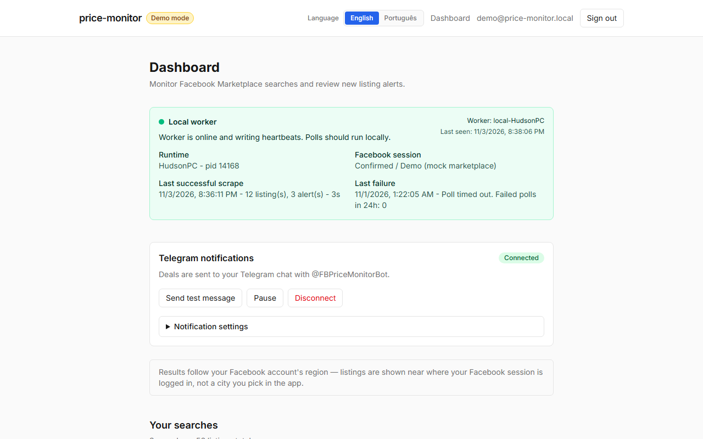
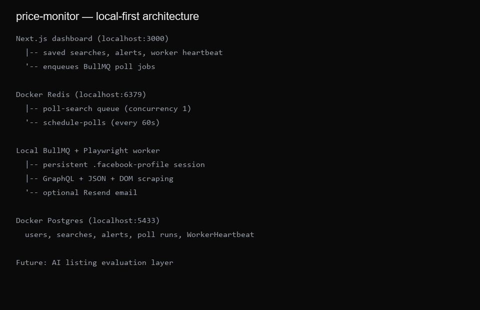
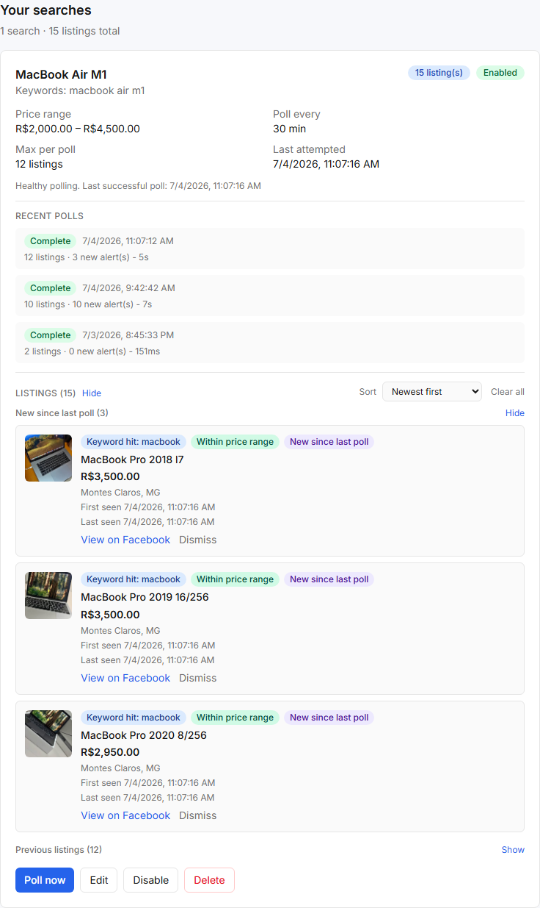

# price-monitor


**Local-first Facebook Marketplace deal monitor** for Brazil. Save keyword + price searches, run a local Playwright worker with your own Facebook browser profile, and review matching listings, price drops, and worker health in a polished dashboard.

This is a **personal, educational, and portfolio project** for exploring scraping resilience, job queues, and local automation. It is **not** authorized Facebook/Meta tooling.

**What it does:** save searches → local worker scrapes Marketplace → diff against per-search history → dashboard alerts.

**How it's built:** Next.js, BullMQ, Playwright, Prisma, local Docker Postgres/Redis, and a persistent local Facebook browser profile.

**Scope and limits:** local worker required, Facebook session is manual — see [Legal notice](#legal-notice) and [design decisions](docs/design-decisions.md).



*Recorded with `npm run demo`: simulated marketplace, real worker, queue, and diffing pipeline. [Try it locally](#try-the-demo-no-facebook-needed) in one command.*

## Highlights

- **273 unit tests + 28 end-to-end integration tests** (real Postgres, Redis, queue and worker, plus a fake Telegram API) — market price statistics, exclusion matching, Telegram notification rules, price history series/downsampling, deterministic mock marketplace catalog, demo-mode guards, Brazilian price parsing, Facebook parsers, poll schedule backoff, rate limits, price-drop logic, deal-quality signals, localized poll queue messages, Zod schemas, adapter merge priority, poll job cleanup, API route auth/ownership/cooldown, middleware path guards
- **Telegram deal alerts** — new matches and price drops pushed to your phone with photo, price and "was R$X (−Y%)"; one-tap linking, quiet hours, drops-only mode, minimum drop %, and per-search switches; works with no public URL
- **Local-first worker** — Facebook-facing browser/session stays on your machine in `.facebook-profile/`
- **Worker heartbeat dashboard** — online/stale/offline state, Facebook session mode, latest successful scrape, and latest failure type
- **Resilient Facebook scraping** — GraphQL interception + embedded JSON + DOM fallback with unified merge
- **Market price comparison** — each search's typical price (outlier-trimmed median of the latest poll), its typical range and 30-day trend, and a "Below market · −22%" badge on clearly cheap listings, also included in Telegram alerts
- **Price history charts** — every listing card shows its price trend; click it for the full history with dated points, lowest/highest/first/latest, and a table view (inline SVG, no chart library)
- **Per-search price memory** — `SavedSearchListingPrice` tracks last seen price per search so overlapping searches still detect drops correctly
- **Reliable polling** — BullMQ job dedup, concurrency 1, exponential failure backoff, stale RUNNING recovery, and manual poll cooldown
- **Brazil-first UX** — `pt-BR` default, BRL cents, Marketplace location hints, with English supported

### Deal intelligence

| Market price per search | A below-market deal |
|-------------------------|---------------------|
|  |  |

| Price history of a listing | Alerts on your phone (real Telegram bot) |
|----------------------------|------------------------------------------|
|  |  |

| Landing | Sign in |
|---------|---------|
|  |  |

| Dashboard (worker online, Telegram connected) | Architecture |
|-----------------------------------------------|--------------|
|  |  |

### Real listing results



## Capabilities

| Area | What you get |
|------|----------------|
| **Saved searches** | Keywords, exclude words (whole words, case- and accent-insensitive: "capa" hides "Capa iPhone" but not "Capacete"), optional min/max price (BRL), poll interval (5–1440 min), listing limit (12/24/48), enable/disable |
| **Polling** | Manual **Poll now** (15 min cooldown) + scheduler every 60s; live status banner and poll run history |
| **Alerts** | New matches and price-drop badges; deal-quality signals (lowest seen, below recent average, below market); sort by date/price; dismiss per alert or clear all |
| **Notifications** | Telegram bot: link from the dashboard, test message, pause, drops-only mode, minimum drop %, quiet hours, per-search on/off; max 5 messages per poll plus a summary |
| **Worker health** | Postgres heartbeat, session mode, latest scrape/failure summaries in the dashboard |
| **Auth** | GitHub + Google OAuth via NextAuth v5 |
| **i18n** | Portuguese (default) and English |

## Try the demo (no Facebook needed)

Requires Node.js 18+ and Docker Desktop running. No Facebook account, no OAuth apps, no Playwright browsers, no `.env` files.

```bash
cd price-monitor
npm install
npm run demo
```

Open [http://localhost:3000](http://localhost:3000) and choose **Continue as demo user**.

What you get:

- A demo user with 3 saved searches and 5 days of poll history: new matches, price drops, deal-quality signals, and one failed poll
- The real worker, queue, and diffing pipeline, fed by a **deterministic simulated marketplace** instead of Facebook: every poll adds new listings and drops some prices
- **Poll now** with a 30-second cooldown (15 minutes in a real setup)

What is mocked: the Facebook scrape (listings, images, and links are generated locally) and sign-in (a single demo user). Everything else is the production code path. The demo uses its own database (`price_monitor_demo`) and Redis DB (`/1`) in the same Docker containers, so it never touches a real local setup. `npm run demo:seed` resets the demo data. Press Ctrl+C to stop the worker and the web app.

Demo sign-in is refused in production builds.

## Quickstart (full local, real Facebook)

Requires Node.js 18+, Docker Desktop, and Playwright Chromium.

```bash
cd price-monitor
npm install
npx playwright install chromium
cp .env.example .env
cp apps/web/.env.example apps/web/.env.local
```

Fill in `AUTH_*` OAuth values in `apps/web/.env.local`. The web app and worker must use the **same** `DATABASE_URL` and `REDIS_URL`.

Cold path (full local — one install, one Facebook profile):

```bash
npm run local:up          # docker Postgres/Redis + db push
npm run facebook:login    # sign in once in the visible browser
npm run spike:facebook    # optional smoke scrape
```

Then keep **two terminals** running:

```bash
# Terminal 1 — worker (must be up or polls look empty/delayed)
npm run worker:dev

# Terminal 2 — web
npm run dev --workspace=@price-monitor/web
```

Open [http://localhost:3000](http://localhost:3000), sign in, create a search, and click **Poll now**. The dashboard should show the local worker heartbeat once `npm run worker:dev` is running. If the worker is missing/offline, fix that first — it is not a bad search keyword.

## Telegram notifications

Get new deals and price drops on your phone the moment a poll finds them. Free, and it works on a local machine with no public URL: the worker long-polls Telegram for messages instead of using a webhook.


*Real messages from a test with a real bot, sent from demo mode. Demo listings have no photo because their images are served from `localhost`; real Marketplace alerts include the listing photo.*

1. In Telegram, open **@BotFather**, send `/newbot`, and choose a name and a username. It replies with a token.
2. Put the token in `.env` as `TELEGRAM_BOT_TOKEN=...` and restart the worker. The log says `Telegram notifications active as @your_bot`.
3. On the dashboard, click **Connect Telegram**, then tap **Start** in the bot. The card switches to *Connected*; use **Send test message** to check.

The token stays in the worker's `.env`; the web app never sees it. Each event (a new match, or a drop at a given time) is sent at most once. A poll sends at most 5 messages (biggest drops first) plus one "and N more" summary. Telegram problems never fail a poll: they show on the dashboard card instead. Send `/stop` to the bot, or click **Disconnect**, to stop notifications.

## Facebook Session Model

The recommended workflow is a persistent local browser profile:

```env
FACEBOOK_BROWSER_PROFILE_DIR=.facebook-profile
PLAYWRIGHT_HEADLESS=false
```

Run `npm run facebook:login` **once** whenever Facebook asks for login, 2FA, checkpoint, or confirmation — and **stop the worker first** so only one process uses `.facebook-profile`. After login, press Enter to close that browser, then start `npm run worker:dev` again. The worker keeps one Chromium window/process open and **reuses the same logged-in session** for every poll until you stop the worker.

The profile is ignored by git and should never be committed.

## Tests and checks

```bash
npm test                  # unit suite (no services needed)
npm run typecheck         # tsc --noEmit in every workspace
npm run lint              # ESLint, zero warnings allowed
npm run test:integration  # end-to-end suite against real Postgres + Redis
```

CI runs the first three and the production build in one job. A second job runs the integration suite against fresh Postgres and Redis service containers.

### Integration suite

`tests/integration/` drives the real pipeline end to end: API route → BullMQ queue (Redis) → worker poll job → Postgres. Only the marketplace (the deterministic mock catalog) and the signed-in session are substituted. It covers:

- **Poll pipeline**: baseline poll, new-match and price-drop alerts on the next poll (checked against the expected catalog), failed polls leaving data untouched, and no duplicates when results are persisted twice
- **API rules**: creation and ownership, 404s for other users across every search route, the manual poll cooldown, queued poll status, and refusing to delete a search mid-poll

Locally, start the services first (`npm run docker:up`). The suite uses its own database (`price_monitor_test`) and Redis DB 2, and refuses to run against anything else, so real and demo data are never touched. Override the targets with `TEST_DATABASE_URL` / `TEST_REDIS_URL`. If a schema change ever makes `db push` refuse to sync the test database, drop it (`docker compose exec postgres dropdb -U price_monitor price_monitor_test`) and rerun.

## API

| Endpoint | Description |
|----------|-------------|
| `GET/POST/PATCH /api/searches` | List, create, update saved searches |
| `DELETE /api/searches/[id]` | Delete search (cancel job; 409 if poll active) |
| `POST /api/searches/[id]/poll` | Enqueue manual poll (rate limited) |
| `GET /api/searches/[id]/poll-status` | BullMQ job state + queue message |
| `GET /api/searches/[id]/poll-runs` | Poll history (`?limit=`) |
| `GET /api/alerts` | Alert feed (`?savedSearchId=`, `?limit=`) |
| `DELETE /api/alerts/[id]` | Dismiss alert |
| `GET/PATCH /api/user/preferences` | Locale preference |
| `GET/PATCH/DELETE /api/telegram` | Telegram status, notification settings, disconnect |
| `POST /api/telegram/link` | One-time `t.me` link for connecting the bot |
| `POST /api/telegram/test` | Ask the worker to send a test message |
| `GET /health` (worker) | Local worker health and Facebook session check |

## Architecture

See [docs/architecture.md](docs/architecture.md) for the full diagram and data flow.

## Configuration

See `.env.example`. Key variables:

| Variable | Description |
|----------|-------------|
| `DATABASE_URL` | PostgreSQL, local Docker by default (port 5433) |
| `REDIS_URL` | Redis for BullMQ, local Docker by default |
| `AUTH_SECRET` | Auth.js / NextAuth secret |
| `FACEBOOK_BROWSER_PROFILE_DIR` | Persistent local Facebook browser profile |
| `TELEGRAM_BOT_TOKEN` | Optional. Enables Telegram notifications (worker only) |

## Design decisions

Extended write-up of architecture and product choices: [docs/design-decisions.md](docs/design-decisions.md).

## Legal notice

Facebook prohibits unauthorized automated data collection without permission. This project is intended for **personal, educational, and portfolio use**. You are responsible for complying with Meta's terms and applicable laws.

## License

See [LICENSE](LICENSE).

